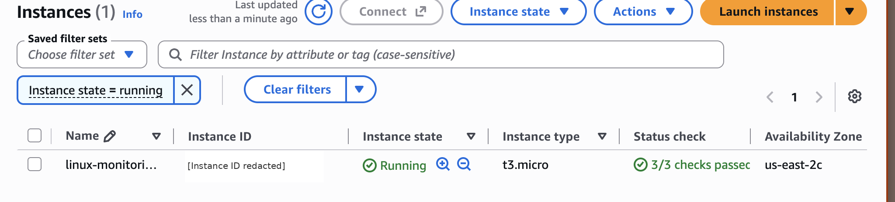
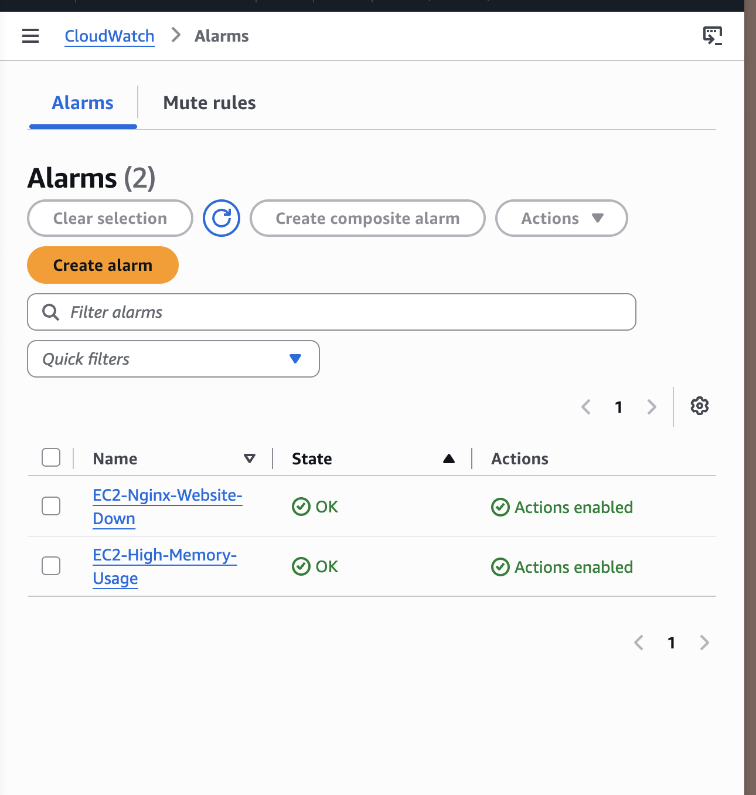
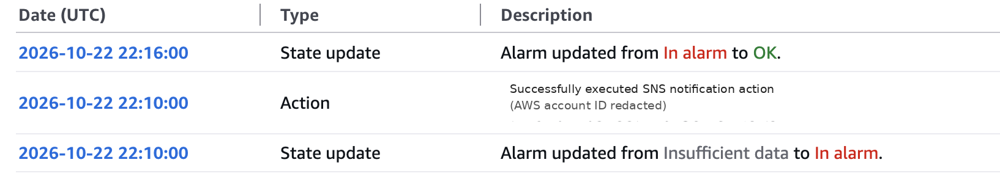
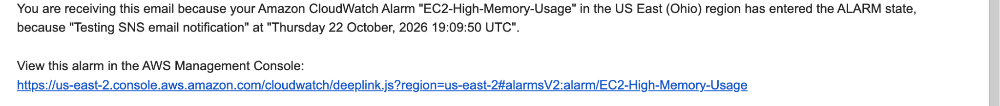

# AWS Linux Server Monitoring & Automated Alerting

A cloud-based Linux server monitoring system deployed on Amazon EC2, using Bash automation, Amazon CloudWatch, and Amazon SNS to monitor system performance, detect website outages, and deliver email notifications.

## Technologies Used

- **Cloud:** AWS EC2, CloudWatch, SNS, IAM
- **Operating System:** Ubuntu Server
- **Web Server:** Nginx
- **Scripting:** Bash
- **Automation:** Cron
- **Monitoring:** CPU, memory, disk usage, Nginx service status, HTTP availability
- **Version Control:** Git and GitHub

## Project Overview

This project began as a local Ubuntu Linux monitoring system and was extended into AWS to demonstrate practical cloud infrastructure management.

An Ubuntu EC2 instance hosts an Nginx website. A custom Bash script collects system health information, checks whether Nginx is running, and verifies that the website responds with HTTP 200.

Cron schedules the monitoring script to execute every five minutes.

The system integrates with Amazon CloudWatch to collect performance metrics and monitor website availability. CloudWatch alarms are connected to Amazon SNS to send email notifications when problems are detected.

## Architecture

```text
                  AWS EC2 (Ubuntu)
                         |
                 +-------+-------+
                 |               |
             Nginx Server    Bash Script
                 |               |
             HTTP Website    Cron (5 min)
                                 |
                                 v
                         Amazon CloudWatch
                                 |
                           CloudWatch Alarms
                                 |
                                 v
                             Amazon SNS
                                 |
                                 v
                         Email Notification
```

An IAM instance role allows the EC2 server to publish metrics to CloudWatch without storing long-lived AWS access keys.

## Features

### 1. Linux System Monitoring

The Bash monitoring script collects:

- CPU utilization
- Memory utilization
- Disk utilization
- Nginx service status
- HTTP website availability

Resource thresholds are set to 80%, and warning messages are recorded when thresholds are exceeded.

### 2. Automated Monitoring

Cron executes the monitoring script every five minutes:

```cron
*/5 * * * * /bin/bash "$HOME/linux-server-project/monitor.sh" >> "$HOME/linux-server-project/cron.log" 2>&1
```

Monitoring results are saved to `monitor.log`, while detected problems are recorded in `alerts.log`.

### 3. AWS CloudWatch Integration

The Amazon CloudWatch Agent collects server performance metrics.

The Bash script also publishes a custom CloudWatch metric called `NginxHealth`:

- `1` — Nginx is running and the website responds with HTTP 200.
- `0` — Nginx is stopped or the website health check fails.

### 4. CloudWatch Alarms

Two alarms monitor the environment:

| Alarm | Purpose |
|---|---|
| EC2-High-Memory-Usage | Detects memory utilization above 80% |
| EC2-Nginx-Website-Down | Detects website health failures |

Both alarms use Amazon SNS to send email notifications.

### 5. AWS IAM

The EC2 instance uses an IAM role to authenticate with AWS services and publish CloudWatch metrics without storing permanent credentials on the server.

## Testing and Validation

### Memory Alarm Notification Test

The CloudWatch memory alarm was manually placed into the ALARM state using AWS CLI.

The test verified that CloudWatch invoked the SNS notification action and that the notification email was received.

### Nginx Outage Test

A controlled outage was performed by stopping the Nginx service:

```bash
sudo systemctl stop nginx
```

The monitoring script detected the outage and published `NginxHealth=0` to CloudWatch.

CloudWatch entered the ALARM state and successfully executed the SNS notification action.

After restarting Nginx:

```bash
sudo systemctl start nginx
```

The script reported the website as healthy, and the CloudWatch alarm eventually returned to OK.

This test verified the complete outage detection, notification, and recovery workflow.

## Project Screenshots

### AWS EC2 Instance



### CloudWatch Alarms



### Nginx Outage Detection



### SNS Email Notification



## Key Takeaways

Through this project, I gained hands-on experience with:

- Deploying and administering Linux servers on AWS EC2
- Automating system monitoring using Bash and cron
- Configuring CloudWatch metrics and alarms
- Using IAM roles for AWS service authentication
- Integrating Amazon SNS for email notifications
- Troubleshooting Linux services and monitoring scripts
- Testing real website outages and verifying alert delivery

## Future Improvements

- Provision infrastructure using Terraform
- Implement CI/CD using GitHub Actions
- Add automated service recovery
- Improve IAM permissions and security hardening
- Create a CloudWatch dashboard for monitoring visualization
